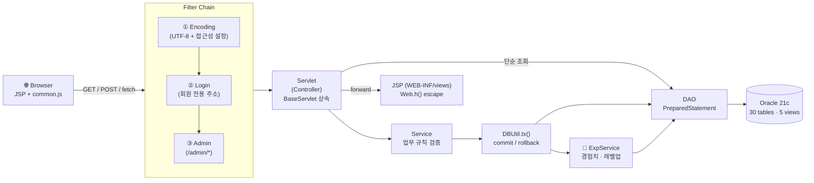

# 📚 MODO_Learn (모두의 강의실)

> **회원 인증 구현 안내:** 추가된 로그인·회원가입은 Java 21 / Servlet / MySQL JDBC 구조이며 View는 제외했습니다. 아래 기존 기획 문서의 Oracle 설명과 구분됩니다.

### 회원 인증 실행 설정

- 로그인: `MemberServlet → LoginService → MemberDAO·DTO`
- 회원가입: `MemberServlet → SignupService → MemberDAO·DTO`
- 로그아웃: `MemberServlet → LogoutService` (세션 폐기)
- `PasswordUtil`은 비밀번호 해시·검증, `LoginFilter`는 비로그인 접근을 `/member/login`으로 이동시킵니다.
- 회원 기능의 `MemberServlet`은 `HttpServlet`을 직접 상속하고 `doGet`/`doPost`에서 요청을 분기합니다. `EncodingFilter → LoginFilter → CsrfFilter` 순서로 공통 처리를 적용하며 별도 Support 클래스는 사용하지 않습니다.
- 기능별 계층은 `member/controller`(요청·forward·redirect), `member/service`(로그인·가입·로그아웃), `member/dao`(SQL), `member/dto`(데이터 전달)입니다. View 연결 경로는 `WEB-INF/views/member`이며 JSP 구현은 이번 범위에서 제외했습니다. 다른 기능도 동일하게 기능 패키지 안에 계층을 추가합니다. 이는 Servlet API를 사용하는 MVC(Model 2) 관례이며 별도의 MVC 프레임워크는 사용하지 않습니다.
- MySQL에 `sql/member-mysql.sql`을 적용하고 기존 `src/main/java/com/modo/common/util/DBUtil.java`의 `URL`, `USER`, `PASSWORD`를 실제 접속 정보로 설정합니다. 원격 코드와 동일하게 `static`에서 드라이버를 로딩하고 `DriverManager.getConnection()`으로 접속합니다. 원격의 `URL`은 빈 문자열이므로 실제 JDBC 주소를 입력해야 합니다(예: `jdbc:mysql://localhost:3306/modo_learn?characterEncoding=UTF-8&serverTimezone=Asia/Seoul`). 기존 테이블이 있다면 별도 구조 검토가 필요하며, 비밀번호 컬럼은 `VARCHAR(255)`를 사용합니다.
- Maven·Gson·JNDI는 필요 없습니다. MySQL JDBC 드라이버는 `WEB-INF/lib`에 포함돼 있습니다.
- URL: `/member/login`, `/member/signup`, `/member/logout`, `/member/me`, `/member/check-id`, `/member/check-email`. 실제 context path를 앞에 붙입니다.
- 로그인·가입 GET은 `X-CSRF-Token` 헤더를 발급합니다. View 미구현 상태에서는 204로 응답합니다. POST에는 같은 세션 쿠키와 `csrfToken` 폼 필드 또는 `X-CSRF-Token` 헤더가 필요하며 본문은 폼 인코딩입니다.
- 가입 필드: `memberId`, `memberPw`, `memberPwConfirm`, `memberName`, `email`, `schoolLevel`, `grade`. 로그인 필드: `memberId`, `memberPw`. 로그인 성공 시 새 세션·토큰을 사용합니다.
- 추후 View 위치는 `WEB-INF/views/member/login.jsp`, `signup.jsp`, `me.jsp`입니다. 해당 파일을 추가하면 Servlet이 연결합니다.
- Eclipse에서 Refresh → Project Clean → 서버 Publish 후 실행합니다.

> **"돈이 없어도, 누구나 좋은 수업을"**
> 흩어진 무료 강의를 초·중·고 학년별로 한곳에 모은 **SDG 4(양질의 교육) 무료 강의 큐레이션 플랫폼**

## 🔗 GitHub Repository
https://github.com/HyeonHo41/MODO_Learn

---

## 📌 프로젝트 소개
모두의 강의실은 EBS · 유튜브 · K-MOOC 등에 흩어진 무료 강의를 **학교급 → 학년 → 과목** 기준으로 한곳에 모으고,
별점·리뷰와 뱃지로 좋은 강의를 쉽게 고를 수 있게 만든 **JSP 기반 강의 큐레이션 웹 서비스**입니다.
사용자가 좋은 강의를 직접 추천하면 관리자가 승인해 게시하고, 부족한 부분은 팀이 만든 자체제작 강의와 PDF 학습 자료로 채웁니다.

기획 단계에서 확정한 **기능 37개**에 더해, 강의를 "모아서 보여 주는" 데서 끝나지 않도록 **창의성 기능 3가지**를 추가했습니다.

- 🐣 **마스코트 성장 + 퀴즈 · 오답노트** : 시청 완료 · 퀴즈 통과 · 리뷰 · 연속 학습으로 경험치를 받아 마스코트가 알 → 아기 → 학생 → 졸업생으로 자랍니다.
- 👀 **시각장애인 접근성** : 글자 크기 · 고대비 · 읽어주기(TTS) · 움직임 끄기를 회원별로 저장해 모든 화면에 적용하고, KWCAG 2.2 점검 항목을 DB로 관리합니다.
- 👂 **청각장애인 자막 · 수어 뱃지** : 강의별 자막(언어 · 사람/자동) · 수어 · 음성해설 정보를 뱃지와 필터로 보여 주고, 자막이 있는 강의는 자막을 켠 채로 재생합니다.

화면은 JSP, 요청 흐름은 Servlet, 업무 규칙과 DB는 Service · DAO가 담당하는 **MVC(Model 2) 구조**로 구현했습니다.

### 🌏 SDG 4 연계
| 세부 목표 | 내용 | 모두의 강의실의 기여 |
|---|---|---|
| 4.1 | 모든 아동의 무상 · 공평 · 양질의 초 · 중등 교육 | 초 · 중 · 고 교과에 맞춘 무료 강의를 학년 · 과목별로 제공 |
| 4.5 | 교육 격차 해소, 취약계층의 동등한 교육 접근 | 비용 없이 누구나 같은 강의에 접근 + 시각 · 청각장애 학생, 다문화 학생(다국어 자막)까지 포함 |

---

## 🗓 개발 기간
- 2026.10.27 ~ 2026.12.14 (7주)

---

## 👥 개발 인원
총 3명 (팀 프로젝트)

- 김현호 : 강의 탐색 · 회원 참여 · 강의 추천 · 메인 · 창의성 기능(마스코트 · 퀴즈 · 접근성 · 자막) · 공통 모듈
- 김재관 : 로그인 · 관리자 기능
- 김성환 : Q&A · 고객센터

---

## 🛠 사용 기술

### Backend
- Java 21
- Jakarta Servlet / JSP (Dynamic Web Module 5.0)
- JDBC (ojdbc11)
- Apache Tomcat 10.1

### Database
- Oracle Database 21c XE (테이블 30개 · 시퀀스 19개 · 트리거 30개 · 뷰 5개)

### Frontend
- HTML5 / CSS3 / JavaScript (fetch API)
- JSP (스크립틀릿 + 표현식, `Web.h()` 이스케이프)
- YouTube 공식 임베드 (IFrame Player API) · Web Speech API (읽어주기)

### Tools
- GitHub
- Eclipse (Dynamic Web Project)
- DBeaver / SQL Developer

---

## ✨ 주요 기능

### 🔍 강의 탐색
- 3단계 분류 목록 (학교급 초 · 중 · 고 → 학년 → 과목) + 페이징
- 강의 상세 : 설명 · 출처 · 원본 링크 · 별점 · 리뷰를 한 화면에, 유튜브 강의는 사이트 안에서 바로 재생
- 복합 필터 (뱃지 · 난이도 · 출처 · 태그 · 별점 4점 이상 · 자막/수어) + 정렬 (최신순 · 조회수순 · 별점순)
- 통합검색 (전체 / 강의 / Q&A / 공지 범위 선택)
- 최근 본 강의 (쿠키, 최대 3개 · 7일 유지)
- 조회수 (같은 세션에서 같은 강의는 1번만 증가)
- 뱃지 자동 표시 : **인기**(조회수 100 이상 + 평균 별점 4.0 이상) · **NEW**(등록 7일 이내) · **자체제작**
- 자체제작 강의 메뉴 + PDF 학습 자료 다운로드

### 👤 회원 · 마이페이지
- 회원가입 (아이디 중복 확인 AJAX, 학교급 · 학년 입력) / 로그인 / 로그아웃
- 이용 제한(BLOCKED) 회원 로그인 차단
- 즐겨찾기 (AJAX 토글) · 내가 쓴 리뷰 · 추천 처리 상태 · 회원정보 수정
- 별점(1~5) · 리뷰 (1인 1강의 1리뷰), 리뷰 "도움돼요" (1인 1회, 다시 누르면 취소)

### 💡 강의 추천 · Q&A · 고객센터
- 강의 추천함 : 링크 · 분류 · 추천 사유 제출 → 관리자 승인 시 강의 목록에 NEW로 게시
- 중복 링크 검사 (등록된 강의 + 대기 중 추천, 유튜브는 영상 ID로 비교)
- 추천 처리 상태 (대기 / 승인 / 반려 + 반려 사유)
- Q&A 게시판 : 질문(학습 / 사이트 이용) · 답변 (답변이 달리면 '답변 완료', 모두 지워지면 다시 '답변 대기')
- 공지사항 · 이벤트 (목록 · 상세 · 이전/다음 글)
- 링크 오류 신고 (삭제 · 비공개 · 분류 오류 등)

### 🏠 메인 화면
- 과목 아이콘 슬라이드 (국어 · 수학 · 영어 · 과학 · 사회 · 역사 · 정보 · 음악 · 미술 · 체육)
- 공지 · 이벤트 배너 자동 슬라이드 (일시정지 가능, 최대 3개)
- 빠른 강의 찾기 (학교급 · 학년 · 과목 · 강의명)
- 맞춤 강의 캐러셀 : 로그인 시 "OO님을 위한 맞춤 강의"(가입 학년 + 즐겨찾기 과목), 비로그인 시 인기 강의
- 학교급별 인기 TOP 5 · 최근 등록 강의 · 자체제작 · 공지 영역

### 🐣 마스코트 성장 · 퀴즈 · 오답노트 (창의성 1)
- 시청 완료 : 강의 상세에서 **'강의를 다 봤어요' 체크**하면 인정 (같은 강의는 하루 1번, 시청 경험치는 하루 10개 강의까지)
- 경험치 → 레벨업 (알 → 아기 → 학생 → 졸업생), 레벨업 알림 창
- 가장 많이 들은 과목에 따라 마스코트 소품(코스튬)이 달라짐 → 사람마다 다른 모습
- 3일 연속 학습 보너스
- 자체제작 단원 퀴즈 서버 채점, 틀린 문제는 오답노트에 저장
- 오답노트에서 퀴즈의 **대표 강의 다시 보기**로 바로 이동 → 강의 → 퀴즈 → 오답 → 다시 강의의 학습 순환

### 👀 시각장애인 접근성 (창의성 2)
- 접근성 설정 : 글자 크기(보통 · 크게 · 아주 크게) · 고대비 · 읽어주기(속도 0.5~2.0배) · 움직임 끄기
- 회원은 DB, 비회원은 쿠키에 저장 → 필터가 모든 화면에 자동 적용
- 마스코트 이미지마다 대체 텍스트(스크린리더가 읽는 문장)
- 관리자 접근성 관리 : KWCAG 2.2 점검 항목 33개를 DB로 관리하고 화면별 점검 결과 기록 (접근성을 "했다"가 아니라 "증명")

### 👂 청각장애인 자막 · 수어 뱃지 (창의성 3)
- 강의별 자막(한국어 · 영어 · 베트남어 · 중국어 · 일본어 / 사람 · 자동) · 수어 · 음성해설 정보
- CC · 수어 뱃지와 목록 필터
- 자막 자동 켜기 설정 시 자막이 켜진 채로 재생 (`cc_load_policy`, 선택한 자막 언어)
- 추천할 때 자막 정보 입력 → 관리자가 확인(검증) 후 뱃지 표시

### 🛠 관리자
- 관리자 대시보드 (승인 대기 추천 · 미처리 신고 · 신규 회원 · 강의 수 · 자막 확인 대기)
- 회원 관리 (검색, 이용 제한 / 해제)
- 강의 관리 (등록 · 수정 · 삭제 · 숨김, 태그 · 자체제작 지정, 유튜브 ID 자동 추출, PDF 업로드)
- 강의 추천 승인 / 반려 (트랜잭션 : 강의 등록 + 추천 상태 변경)
- 링크 오류 신고 처리 (링크 수정 / 강의 숨김 / 문제없음)
- 공지 관리 (배너 최대 3개 · 상단 고정)
- 퀴즈 관리 (퀴즈 · 문항 등록, 공개 설정)
- 접근성 관리 (자막 정보 확인, KWCAG 점검 기록)

---

## 🌱 창의성 기능 정리

### 경험치 규칙 (`exp_rule`)
| 행동 | 경험치 | 하루 한도 | 부정 방지 규칙 |
|---|---|---|---|
| 강의 시청 완료 | +10 | 10회 | '다 봤어요' 체크 · 같은 강의는 하루 1번 (`watch_log` UNIQUE) |
| 퀴즈 통과 | +30 | - | 같은 퀴즈는 처음 통과할 때 1번만 |
| 리뷰 작성 | +5 | 3회 | 리뷰 1개당 1번 |
| 3일 연속 학습 | +15 | 1회 | 시청 완료나 퀴즈 응시를 3일 연속 할 때마다 |

### 마스코트 레벨 (`mascot_level`)
| 레벨 | 이름 | 필요 누적 경험치 |
|---|---|---|
| Lv1 | 🥚 알 | 0 |
| Lv2 | 🐣 아기 | 100 |
| Lv3 | 🎒 학생 | 300 |
| Lv4 | 🎓 졸업생 | 700 |

- 경험치 규칙과 레벨 기준은 코드가 아니라 **DB 표로 관리**해, 기준을 바꿀 때 표만 고치면 됩니다.
- 하루 1번 · 같은 대상 1번 같은 규칙은 Java 검사와 함께 **`exp_log` UNIQUE 제약**으로 한 번 더 막습니다.

---

## 💡 핵심 구현 포인트

- **MVC 분리** : View(JSP)는 request 속성만 출력, Controller(Servlet)는 파라미터 검사 → DAO/Service 호출 → forward · redirect · JSON, Model(Service · DAO)이 SQL과 업무 규칙 담당
- **트랜잭션 관리** : `DBUtil.tx()` 하나로 연결 → 자동 커밋 끄기 → 작업 → 커밋 / 실패 시 롤백 (추천 승인, 퀴즈 채점, 경험치 지급 등)
- **Service 계층** : `MemberService` · `CommunityService`(리뷰) · `StudyService`(시청 완료 · 퀴즈 채점) · `LectureService`(강의 저장 · 추천 승인 · 신고 처리) · `ExpService`(경험치 · 레벨업)
- **예외 처리** : 업무 규칙 위반은 `AppException`(화면 안내 문구), DB 오류는 `DbException`(중복 ORA-00001 구분) → 500 대신 안내 문구, 그 밖의 오류는 공통 `error.jsp` (AJAX면 JSON)
- **PRG 패턴** : POST 처리 후 항상 redirect → 새로고침해도 중복 저장되지 않음
- **이중 안전장치** : Java 검증 + DB 제약조건 (CHECK · UNIQUE · FK), 입력 길이는 `VARCHAR2(n CHAR)`에 맞춰 서버에서 먼저 검사
- **소프트 삭제** : 모든 테이블에 `del_yn` · `reg_date` · `mod_date`, 수정일은 트리거가 자동 갱신
- **보안**
  - SHA-256 비밀번호, PreparedStatement(SQL 인젝션 방지), 출력 escape(XSS 방지)
  - 로그인 시 기존 세션 무효화(세션 고정 방지), 세션 쿠키 HttpOnly, SameSite=Lax(CSRF 완화)
  - JSP는 `WEB-INF` 아래에 두어 직접 접근 차단
  - PDF 업로드는 확장자 + 파일 앞 4바이트(`%PDF`) 확인, 최대 10MB, 서버에는 UUID 이름으로 저장

### 요청 처리 흐름
```
브라우저 ─(GET/POST)─▶ [필터 3개] ─▶ Servlet ─▶ Service ─▶ DAO ─▶ Oracle
                       ① EncodingFilter (UTF-8 + 접근성 설정 주입)
                       ② LoginFilter    (회원 전용 주소)
                       ③ AdminFilter    (/admin/*, 관리자 메뉴 숫자)
```

---

## 🧩 팀원별 담당 기능

### 🔐 김재관 — 로그인 · 관리자
- 회원가입 (아이디 중복 확인), 로그인 / 로그아웃, 이용 제한 회원 차단
- 관리자 대시보드, 회원 관리 (이용 제한 / 해제)
- 강의 관리 (등록 · 수정 · 삭제 · 숨김, PDF 업로드), 강의 추천 승인 / 반려
- 링크 오류 신고 처리, 공지 관리, 퀴즈 관리, 접근성 관리 (자막 확인 · KWCAG 점검)
- 공통 : LoginFilter, AdminFilter, LoginUser(로그인 세션)

### 💬 김성환 — Q&A · 고객센터
- Q&A 목록 · 상세 · 질문 작성 · 삭제
- 답변 작성 · 삭제 (답변이 달리면 질문 상태를 '답변 완료'로)
- 공지사항 · 이벤트 목록 · 상세
- 링크 오류 신고 접수 (강의 상세의 신고 창)

### 📚 김현호 — 강의 탐색 · 회원 참여 · 메인 · 창의성 기능 · 공통
- 3단계 분류 목록, 강의 상세 · 영상 재생, 필터 · 정렬, 통합검색, 최근 본 강의, 뱃지, 자체제작 메뉴
- 즐겨찾기, 별점 · 리뷰 · 도움돼요, 마이페이지 (즐겨찾기 · 내 리뷰 · 추천 상태 · 회원정보 수정)
- 강의 추천함, 중복 링크 검사
- 메인 화면 (과목 아이콘 · 배너 · 빠른 찾기 · 맞춤 강의 · 인기/최신)
- 마스코트 성장, 시청 완료 판정, 퀴즈 · 오답노트, 접근성 설정, 자막 · 수어 뱃지
- 공통 : DBUtil(+tx), BaseServlet, Web · Html(이스케이프 · 강의 카드 · 페이지 번호), EncodingFilter, header · footer, style.css, common.js, DB 스크립트

---

## 🗂 프로젝트 구조
```
MODO_Learn/
├─ sql/
│   ├─ 00_계정생성_SYSTEM으로실행.sql   modo 계정 생성
│   ├─ 01_모두의강의실_DB_v2_Oracle.sql 기본 테이블 14개 + 샘플 데이터
│   └─ 02_창의성추가.sql                창의성 테이블 16개 + 샘플 데이터
├─ src/main/java/
│   ├─ app.properties                  DB 접속 정보 · 시청 인정 비율 · 업로드 폴더
│   └─ com/moduedu/
│       ├─ common/   공통 (AppConfig, DBUtil, BaseServlet, Web, Html, Sha256, YoutubeUtil, Paging ...)
│       ├─ filter/   EncodingFilter, LoginFilter, AdminFilter
│       ├─ dto/      record 22개 (Lecture, Member, Review, Quiz, Growth, A11ySetting ...)
│       ├─ dao/      Lecture · Member · Review · Suggestion · Qna · Notice · Report · Quiz · Growth · Access · Search DAO
│       ├─ service/  MemberService, CommunityService, StudyService, LectureService, ExpService
│       └─ web/      Main · Lecture · Search · Member · MyPage · Review · Suggest · Qna · Notice
│           │        · Report · File · Mascot · Quiz · A11y Servlet
│           └─ admin/  Admin(대시보드 · 회원 · 신고) · AdminLecture · AdminSuggest · AdminNotice
│                      · AdminQuiz · AdminAccess Servlet
└─ src/main/webapp/
    ├─ index.jsp                 /main 으로 이동
    ├─ css/style.css             고대비 · 글자 크기 · 움직임 끄기 포함
    ├─ js/common.js              AJAX · 슬라이드 · 읽어주기 · 시청 판정
    ├─ img/mascot/*.svg          레벨 4종 + 과목 코스튬 11종
    ├─ META-INF/context.xml      쿠키 SameSite=Lax
    └─ WEB-INF/
        ├─ web.xml               필터 순서, 오류 화면 (400 · 403 · 404 · 405 · 500)
        ├─ lib/ojdbc11.jar
        └─ views/                JSP (서블릿을 통해서만 접근)
            ├─ common/  header · footer · mypageSide · adminMenu (.jspf)
            ├─ lecture/ search/ member/ mypage/ suggest/ qna/ notice/
            ├─ mascot/ quiz/ a11y/
            └─ admin/
```
- Java 72개 · JSP 36개 (+ 공통 JSPF 4개) · CSS 1개 · JS 1개 · SVG 16개

---

## 🏗 아키텍처



| 계층 | 책임 | **하지 않는 것** |
|---|---|---|
| **JSP** (View) | 서블릿이 넘긴 request 속성 출력, 모든 값 `Web.h()` escape | DB 접근, 쿠키 직접 읽기, 업무 판단 |
| **Servlet** (Controller) | 파라미터 · 형식 · 길이 검사, GET → forward / POST → redirect / AJAX → JSON | SQL, Connection, 트랜잭션 |
| **Service** (Model) | 여러 SQL을 묶는 트랜잭션, 업무 규칙 (승인 · 채점 · 경험치) | 화면 출력 |
| **DAO** (Model) | `?` 바인딩 SQL 실행, ResultSet → record 변환 | 업무 판단, 커밋 |

---

## ✨ ERD
시스템의 데이터베이스 구조를 나타낸 ERD입니다. (테이블 30개 = 기본 14개 + 창의성 16개, 시퀀스 19개, 뷰 5개)

(ERD 이미지 첨부)

| 담당 | 테이블 |
|---|---|
| 팀원 김재관 | users, a11y_guide, a11y_check |
| 팀원 김성환 | question, answer, notice, report |
| 팀원 김현호 | category, lecture, tag, lecture_tag, lecture_file, favorite, review, review_like, suggestion, mascot_level, mascot_costume, user_growth, exp_rule, exp_log, watch_log, level_history, quiz, quiz_item, quiz_result, quiz_answer, wrong_note, a11y_setting, lecture_access |

| 뷰 | 내용 |
|---|---|
| lecture_summary | 강의 + 분류 + 평균 별점 + 인기 · NEW 여부 + 영상 길이 |
| question_summary | 질문 + 작성자 이름 · 분류 · 답변 수 |
| growth_summary | 회원 경험치 · 레벨 · 코스튬 · 다음 레벨까지 진행률 · 연속 학습 일수 |
| quiz_summary | 퀴즈 + 분류 · 통과 점수 · 문항 수 |
| lecture_access_summary | 강의별 자막 · 수어 · 음성해설 뱃지 |

---

## ▶ 실행 방법

1. **DB 계정 만들기** — SQL Developer / DBeaver에서 **SYSTEM** 계정으로 `localhost:1521/XEPDB1`에 접속해 `sql/00_계정생성_SYSTEM으로실행.sql`을 실행합니다. (`modo` 계정 생성)
2. **테이블 · 샘플 데이터** — `modo` 계정으로 접속해 `01_모두의강의실_DB_v2_Oracle.sql` → `02_창의성추가.sql` 순서로 **스크립트 실행(F5)** 합니다.
   - 01을 다시 실행하면 02의 테이블도 지워지므로 02도 다시 실행합니다.
   - SQL*Plus로 실행할 때는 한글이 깨지지 않게 먼저 `set NLS_LANG=KOREAN_KOREA.AL32UTF8`
3. **프로젝트 가져오기** — Eclipse에서 `File → Import → Existing Projects into Workspace`로 MODO_Learn을 가져옵니다. (Java 21, 대상 런타임 Apache Tomcat v10.1)
4. **서버 실행** — Servers 탭에서 Tomcat v10.1에 MODO_Learn을 추가(Add and Remove)하고 Start 합니다.
5. **접속** — 브라우저에서 `http://localhost:8080/MODO_Learn` 으로 접속합니다.

> DB 접속 정보가 다르면 `src/main/java/app.properties`의 `db.url` · `db.user` · `db.password`만 수정하면 됩니다.

### 테스트 계정
| 구분 | 아이디 | 비밀번호 | 비고 |
|---|---|---|---|
| 일반 회원 | minji2026 | test1234 | 중학교 2학년, 마스코트 Lv2, 오답 1개 |
| 관리자 | admin | admin1234 | |

---

## 📸 시연 화면
(추후 스크린샷 추가 예정)
